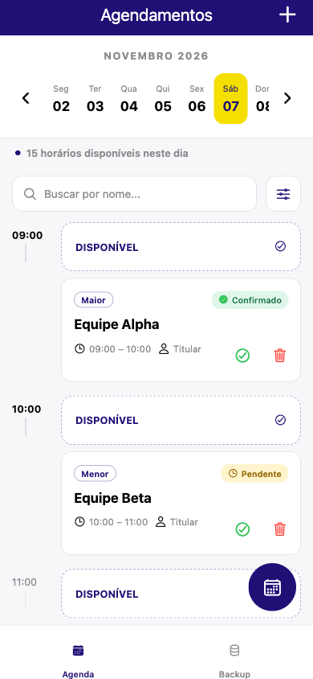
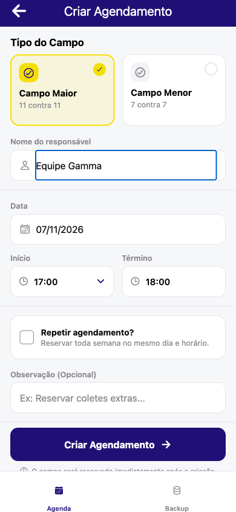
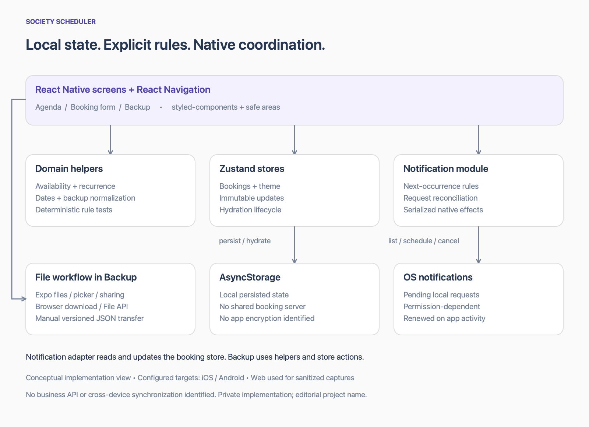

# Society Scheduler

### Bookings, weekly recurrence and local reminders with React Native and Expo

[Português](README.md) · [Architecture](docs/architecture.md) · [Engineering decisions](docs/engineering-decisions.md) · [Technical challenges](docs/technical-challenges.md) · [Testing and delivery](docs/testing-and-delivery.md)

Society Scheduler is a booking management app for a small-sided football venue: it brings together an agenda, availability checks, weekly reservations, booking confirmation and data backups. Its engineering challenges include detecting recurring conflicts without a fixed annual horizon, keeping reminders consistent with operating-system requests and restoring older data formats.

## Demo

Real captures from a sanitized **web preview at 390 × 844 CSS pixels**, using fictitious teams. The GIF is a tour of these screens, not an interaction recording or a native release demo. [Media provenance](assets/README.md)

| Agenda | Booking form | Backup |
| --- | --- | --- |
|  |  |  |

## My Contributions

The Git history attributes contributions to **Gustavo** in the following areas:

- **SDK and dependencies:** updates to the Expo/React Native foundation and project configuration.
- **Backup and restoration:** evolution of import/export workflows and compatibility with legacy formats.
- **Scheduling rules:** fixes for recurring conflicts and booking interval boundaries.
- **Local notifications:** native request reconciliation and operation serialization to handle missing or duplicate reminders.
- **Automated tests:** checks for scheduling rules, backups and notification coordination.

**Codex was used to assist development.** This list describes Git-attributed contributions; it does not claim sole authorship of the application or establish how each implementation was divided between people and agents. [Contribution evidence](docs/evidence.md#e09--attribution)

## Architecture at a glance

React Native screens → domain helpers and Zustand → AsyncStorage. Expo Notifications reconciles local reminders with operating-system requests; platform file APIs handle manual JSON backup transfer. No business backend or remote synchronization was identified. [Architecture details](docs/architecture.md)

## Three technical decisions

- **Recurring availability:** explicit comparisons between one-off and weekly reservations avoid a fixed annual conflict-checking horizon and respect resource identity and excluded occurrences. [E03](docs/evidence.md)
- **Reminder reconciliation:** application state is compared with pending operating-system notification requests; valid requests are reused, duplicates are cancelled, and effects are serialized. [E04](docs/evidence.md)
- **Data evolution:** versioned backup import normalizes legacy records and removes device-specific notification metadata before rebuilding local reminders. [E05](docs/evidence.md)

Hydration guards and explicit replacement confirmation also protect restoration from acting on its initial empty state. [E02, E05](docs/evidence.md)

## Technology stack

| Area | Applied technologies |
| --- | --- |
| Mobile foundation | React Native 0.86.3, React 19.2.3, Expo 57.0.26 |
| Language and navigation | TypeScript 6.0.3; React Navigation native stack and bottom tabs |
| State and persistence | Zustand 4.0.0; AsyncStorage 2.2.0 |
| UI | styled-components, Expo Vector Icons, Safe Area Context, Size Matters |
| Rules and validation | date-fns; Yup with additional domain validation |
| Platform integrations | Expo Notifications, FileSystem, DocumentPicker, Sharing and Updates |
| Quality and packaging | Node test runner through tsx, ESLint, Bun and EAS configuration |

Versions identify the inspected local installation, not proof of a successful native release. Reanimated is declared in the project but is not presented here as an implemented animation feature. No business API client or backend implementation was identified. [E00, E06, E08](docs/evidence.md)

## Technical challenges

The deeper case studies cover recurring conflict detection, reconciling native reminders, preserving legacy backups, ordering hydration and destructive restore operations, and adapting file workflows across platforms. Each explains the implementation, observable benefit and remaining limitation. [Read the five challenges](docs/technical-challenges.md)

## Testing and quality

The review on **7 November 2026** recorded **36 passing tests** and TypeScript checking with no errors. The suite covers scheduling rules, backups and notification coordination through simulated operations.

ESLint findings and an observed web-preview runtime error remain open; full results, limitations and outstanding native validation are documented in [Testing, quality and delivery](docs/testing-and-delivery.md). These checks do not establish production readiness.

## About this showcase

Society Scheduler is an editorial name. The source code and original brand remain private; this repository contains only documentation and sanitized media, with publication authorized. [Disclosure scope](docs/disclosure.md)

Connect with Gustavo on [LinkedIn](https://www.linkedin.com/in/gustavo-santana-83ba611a6/).
