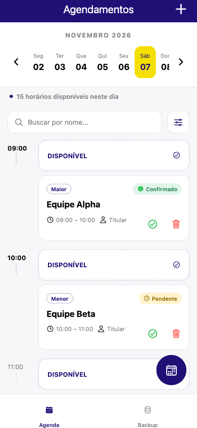
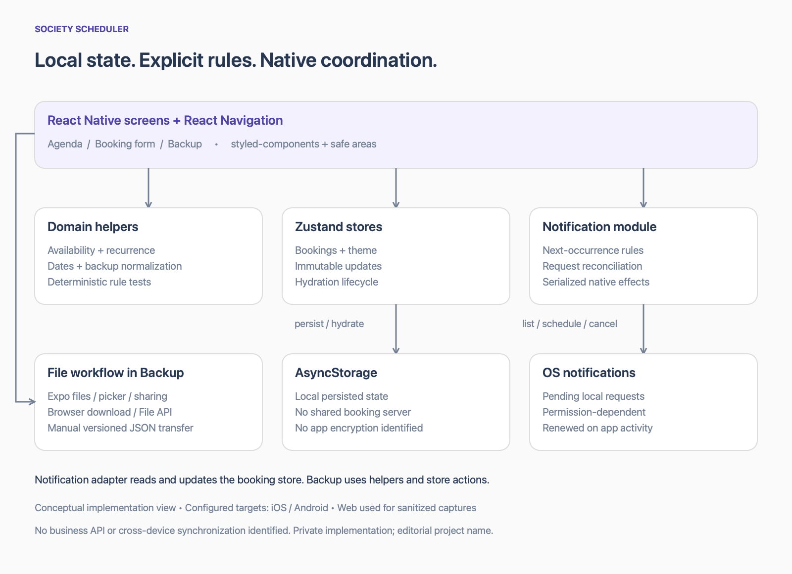

# Society Scheduler

### Reservas, recorrência e lembretes locais com React Native e Expo

[English](README.en.md) · [Arquitetura](docs/architecture.md) · [Decisões](docs/engineering-decisions.md) · [Desafios](docs/technical-challenges.md) · [Testes e entrega](docs/testing-and-delivery.md)

Society Scheduler é um aplicativo de gestão de reservas para society: reúne agenda, consulta de disponibilidade, horários semanais, confirmação de reservas e backup de dados. Os desafios de engenharia incluem detectar conflitos recorrentes sem horizonte anual fixo, manter lembretes consistentes com o sistema operacional e restaurar dados de versões anteriores.

## Demonstração

Capturas reais de um preview web sanitizado em **390 × 844 CSS pixels**, com equipes fictícias. O GIF é um tour dessas telas, não uma gravação de interação nem demonstração de release nativa. [Origem da mídia](assets/README.md)

| Agenda | Formulário | Backup |
| --- | --- | --- |
|  |  |  |

## Minhas contribuições

O histórico Git atribui a **Gustavo** contribuições nas seguintes frentes:

- **SDK e dependências:** atualização da base Expo/React Native e das configurações do projeto.
- **Backup e restauração:** evolução dos fluxos de importação/exportação e compatibilidade com formatos legados.
- **Regras de agenda:** correções de conflitos recorrentes e limites dos intervalos de horários.
- **Notificações locais:** reconciliação de requests nativos e serialização de operações para tratar lembretes ausentes ou duplicados.
- **Testes automatizados:** verificações de regras, backups e coordenação de notificações.

O **Codex foi utilizado como ferramenta de assistência ao desenvolvimento**. A lista descreve contribuições registradas no Git; não representa autoria exclusiva do aplicativo nem define a divisão de cada implementação entre pessoas e agentes. [Evidências de contribuição](docs/evidence.md#e09--attribution)

## Arquitetura em resumo

Telas React Native → helpers de domínio e Zustand → AsyncStorage. Expo Notifications reconcilia lembretes locais com requests do sistema operacional; APIs de arquivos permitem transferência manual por backup JSON. Não foi identificado backend de negócio ou sincronização remota. [Detalhes da arquitetura](docs/architecture.md)

## Três decisões técnicas

- **Disponibilidade recorrente:** comparação explícita entre reservas pontuais e semanais, sem horizonte anual fixo, considerando recurso e ocorrências excluídas. [E03](docs/evidence.md)
- **Reconciliação de lembretes:** comparação entre estado persistido e requests pendentes no sistema operacional, com reaproveitamento, cancelamento de duplicados e serialização dos efeitos. [E04](docs/evidence.md)
- **Evolução de dados:** importação versionada normaliza registros legados e remove metadados de notificações específicos do aparelho. [E05](docs/evidence.md)

A restauração também bloqueia ações de backup antes da hidratação e exige confirmação explícita antes da substituição. [E02, E05](docs/evidence.md)

## Stack aplicada

| Área | Tecnologias |
| --- | --- |
| Base mobile | React Native 0.86.3, React 19.2.3, Expo 57.0.26 |
| Linguagem e navegação | TypeScript 6.0.3; React Navigation com native stack e bottom tabs |
| Estado e persistência | Zustand 4.0.0; AsyncStorage 2.2.0 |
| Interface | styled-components, Expo Vector Icons, Safe Area Context, Size Matters |
| Regras e validação | date-fns; Yup e validação complementar de domínio |
| Integrações de plataforma | Expo Notifications, FileSystem, DocumentPicker, Sharing e Updates |
| Qualidade e empacotamento | Node test runner com tsx, ESLint, Bun e configuração EAS |

As versões correspondem à instalação local examinada e não comprovam release nativa. Reanimated está declarado, mas não é apresentado como funcionalidade de animação implementada. Não foi identificado cliente de API de negócio ou backend desenvolvido neste projeto. [E00, E06, E08](docs/evidence.md)

## Desafios técnicos

Os cinco estudos detalham detecção de conflitos recorrentes, consistência de lembretes nativos, compatibilidade de backups, hidratação e restauração destrutiva, além da adaptação dos fluxos de arquivos. Cada um apresenta implementação, benefício observável e limitações. [Ler os desafios](docs/technical-challenges.md)

## Testes e qualidade

Na revisão de **7 de novembro de 2026**, **36 testes passaram** e a checagem TypeScript terminou sem erros. A suíte cobre regras de agenda, backups e coordenação de notificações com operações simuladas.

Há pendências de ESLint e um erro observado no preview web; os resultados completos, as limitações e as validações nativas ainda necessárias estão em [Testes, qualidade e entrega](docs/testing-and-delivery.md). Essas verificações não estabelecem prontidão para produção.

## Sobre este showcase

Society Scheduler é um nome editorial. O código-fonte e a marca original permanecem privados; este repositório apresenta somente documentação e mídia sanitizada, com publicação autorizada. [Escopo de divulgação](docs/disclosure.md)

Conheça o perfil de Gustavo no [LinkedIn](https://www.linkedin.com/in/gustavo-santana-83ba611a6/).
