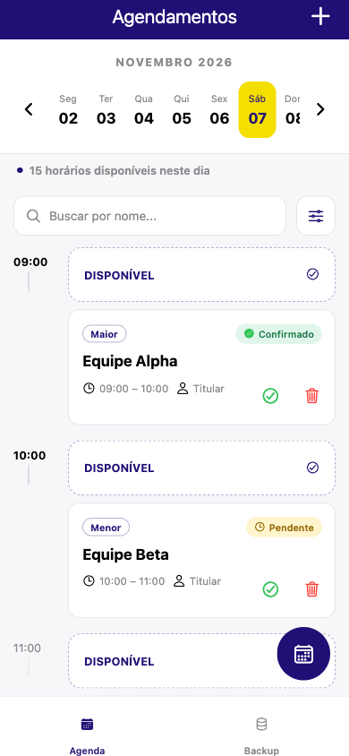
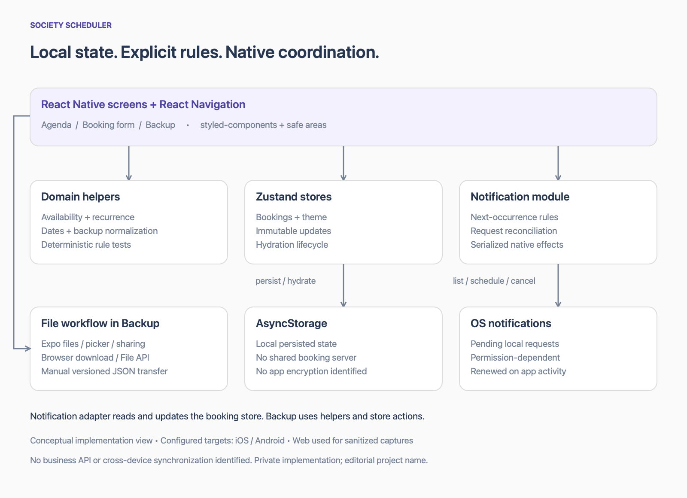
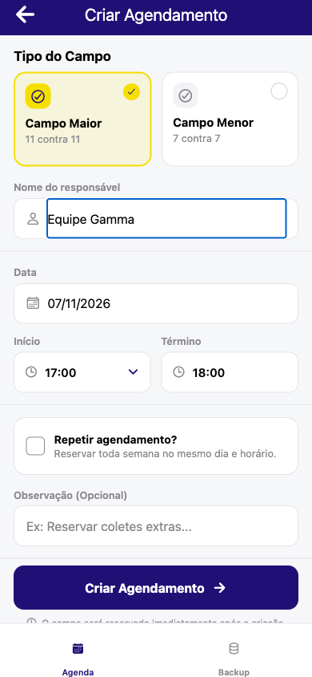
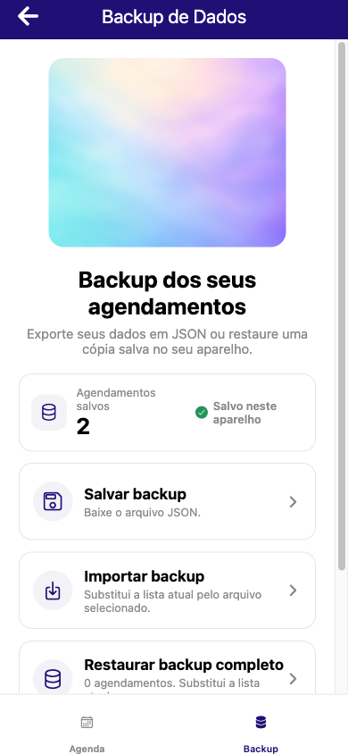

# Society Scheduler

### Estudo de engenharia React Native · alvos iOS e Android

[English](README.md) · [Arquitetura](docs/architecture.md) · [Decisões](docs/engineering-decisions.md) · [Desafios](docs/technical-challenges.md) · [Testes e entrega](docs/testing-and-delivery.md)

Society Scheduler é um nome editorial para um aplicativo privado de gestão de reservas de um society. Este showcase documental apresenta a engenharia do modelo local, das reservas recorrentes e dos lembretes nativos. A marca original e a implementação permanecem privadas.

## Arquitetura em resumo

Telas React Native → helpers de domínio e Zustand → AsyncStorage. Expo Notifications reconcilia lembretes locais com requests do sistema operacional; APIs de arquivos permitem transferência manual por backup JSON. Não foi identificado backend de negócio ou sincronização remota. [Detalhes da arquitetura](docs/architecture.md)

## Tour de telas — capturas web sanitizadas

O GIF é um slideshow de capturas reais, não uma gravação de interação ou demonstração de release nativa. [Origem da mídia](assets/README.md)

## Problema e produto

A operação precisa consultar disponibilidade, evitar sobreposição de reservas, administrar horários semanais e preservar registros na troca de aparelho. O aplicativo atende esses fluxos com agenda persistida localmente e transferência manual por backup JSON. O público operador é inferido pelos fluxos existentes; adoção e impacto comercial não foram verificados. [E01, E02](docs/evidence.md)

Há navegação por data/semana, calendário mensal, busca e filtros, criação e confirmação de reservas, recorrência semanal com exclusões por data, detalhes, lembretes locais e importação/exportação de backup. iOS e Android são alvos configurados; existe também execução web. [E01, E03, E04](docs/evidence.md)

## Três decisões técnicas

- **Disponibilidade recorrente:** comparação explícita entre reservas pontuais e semanais, sem horizonte anual fixo, considerando recurso e ocorrências excluídas. [E03](docs/evidence.md)
- **Reconciliação de lembretes:** comparação entre estado persistido e requests pendentes no sistema operacional, com reaproveitamento, cancelamento de duplicados e serialização dos efeitos. [E04](docs/evidence.md)
- **Evolução de dados:** importação versionada normaliza registros legados e remove metadados de notificações específicos do aparelho. [E05](docs/evidence.md)

A restauração também bloqueia ações de backup antes da hidratação e exige confirmação explícita antes da substituição. [E02, E05](docs/evidence.md)

## Stack aplicada

| Área | Tecnologias |
| --- | --- |
| Base mobile | React Native 0.86.3, React 19.2.3, Expo 57.0.26 |
| Linguagem e navegação | TypeScript 6.0.3; React Navigation com native stack e bottom tabs |
| Estado e persistência | Zustand 4.0.0; AsyncStorage 2.2.0 |
| Interface | styled-components, Expo Vector Icons, Safe Area Context, Size Matters |
| Regras e validação | date-fns; Yup e validação complementar de domínio |
| Integrações de plataforma | Expo Notifications, FileSystem, DocumentPicker, Sharing e Updates |
| Qualidade e empacotamento | Node test runner com tsx, ESLint, Bun e configuração EAS |

As versões correspondem à instalação local examinada e não comprovam release nativa. Reanimated está declarado, mas não é apresentado como funcionalidade de animação implementada. Não foi identificado cliente de API de negócio ou backend desenvolvido neste projeto. [E00, E06, E08](docs/evidence.md)

## Arquitetura

As telas chamam helpers de domínio e ações Zustand. O AsyncStorage persiste as reservas. Um adaptador coordena os efeitos nativos de notificações por meio de um reconciliador testável. O backup conecta o modelo local às APIs de arquivos de cada plataforma. A descrição se limita às fronteiras efetivamente presentes. [Detalhamento da arquitetura](docs/architecture.md)

## Desafios técnicos

Os cinco estudos detalham detecção de conflitos recorrentes, consistência de lembretes nativos, compatibilidade de backups, hidratação e restauração destrutiva, além da adaptação dos fluxos de arquivos. Cada um apresenta implementação, benefício observável e limitações. [Ler os desafios](docs/technical-challenges.md)

## Testes, qualidade e entrega

Na revisão de **7 de novembro de 2026**, os **36 testes passaram** e a checagem TypeScript terminou com código 0. A suíte testa regras, migrações, permissões e coordenação de notificações com operações simuladas; não comprova entrega no aparelho. O ESLint apresentou **44 erros e 443 avisos**. [E07](docs/evidence.md)

Os perfis EAS configuram distribuição interna para development/preview e APK Android em production. Há configuração Expo Updates. Publicação nas lojas, build nativa assinada atual, execução de CI e rollout OTA não foram verificados. A captura web também registrou erro React durante uma navegação, com causa ainda não investigada. [Escopo dos testes e da entrega](docs/testing-and-delivery.md)

## Imagens e demonstração

As capturas vieram de um **preview web isolado e sanitizado em 390 × 844 CSS pixels**, com equipes fictícias. Marca, identificadores de infraestrutura e backups potencialmente reais foram removidos da cópia de demonstração. As imagens não representam releases nativas validadas. [Origem das imagens](assets/README.md)

| Agenda | Formulário | Backup |
| --- | --- | --- |
|  |  |  |

[Abrir sequência animada das telas](assets/demo.gif). O GIF reúne essas capturas; não é gravação de uma transação ponta a ponta.

## Minha contribuição: evidências e limites

O histórico Git privado atribui a **Gustavo** commits de manutenção envolvendo SDK/dependências, backup, regras de agenda, reconciliação de notificações, testes e configuração do projeto. Essa atribuição não comprova autoria exclusiva. A ligação entre aliases históricos, responsabilidades pessoais, colaboração e uso de ferramentas de assistência ainda depende de confirmação. [Registro de atribuição](docs/evidence.md#e09--attribution)

## Código privado e divulgação

Este repositório contém documentação e mídia sanitizada. Não inclui código proprietário, registros de negócio, endpoints privados, credenciais, pacotes nativos ou source maps. Não é um aplicativo instalável. A publicação desta documentação e das imagens sanitizadas foi autorizada com omissão da marca original. [Escopo de divulgação](docs/disclosure.md)

Conheça o perfil de Gustavo no [LinkedIn](https://www.linkedin.com/in/gustavo-santana-83ba611a6/).
