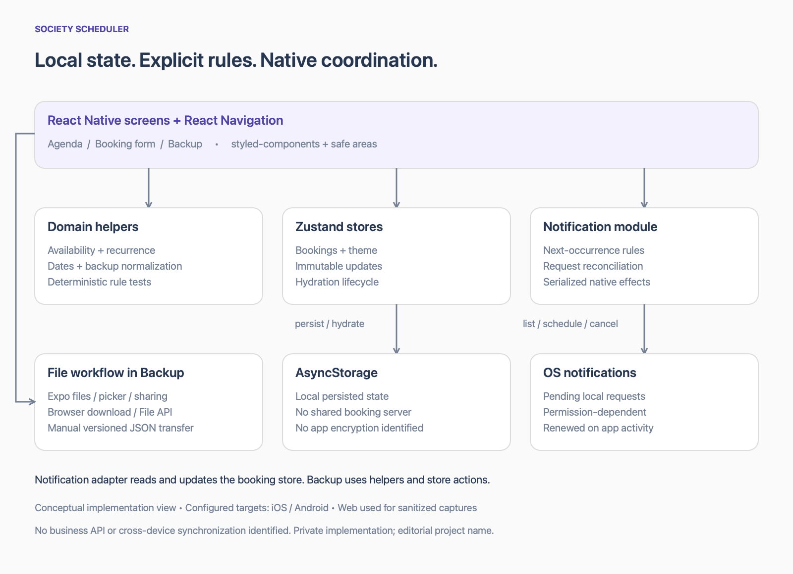

# Architecture

[Back to the overview](../README.md)

## Product boundary

The reviewed application is a local booking manager for a football venue. iOS and Android are configured targets, and React Native Web supports a preview path. There is no identified business backend or shared server-side authority for reservations. The booking store is the application’s local source of truth; notification requests have a separate operating-system lifecycle. [E01, E02, E04](evidence.md)

## Responsibilities

| Boundary | Implemented responsibility | Important limit |
| --- | --- | --- |
| Navigation and screens | Agenda, booking creation, confirmation, filtering, backup actions and feedback | Screens also orchestrate domain operations; there is no universal use-case layer |
| Domain helpers | Date/interval parsing, applicability, resource availability, backup normalization and agenda slots | Some configuration is imported from a screen constants directory |
| Zustand stores | Immutable booking updates and theme selection | Whole booking-array changes can invalidate derived calculations |
| AsyncStorage persistence | Restore and persist local state | No application-level encryption or cross-device synchronization identified |
| Notification rules | Compute next eligible occurrence; reconcile matching requests | One next reminder is scheduled; app lifecycle activity renews it |
| Native notification adapter | Permission, listing, cancellation, scheduling and identifier persistence | Operating-system effects are not atomic with persisted state |
| File integration | Export/import JSON through platform-specific file interfaces | Manual replacement, not collaborative synchronization |
| Update integration | Fetch/reload updates outside development and configured EAS channels | No verified deployment or rollback history |

These are observed boundaries, not a claim that the entire application implements Clean Architecture, DDD or MVVM. [E02–E06, E08](evidence.md)

## Booking data flow

1. Navigation can prefill the date, interval and available field on the booking form.
2. The form validates required inputs through Yup and checks dates, intervals, operating slots and conflicts through helpers.
3. A pending booking is added to the Zustand store and persisted through its AsyncStorage middleware.
4. Agenda selectors and memoized calculations derive the selected day, filters, visible slots and availability.
5. Manual confirmation changes the status and attempts to reconcile a reminder. A reminder failure does not undo the booking confirmation; the UI explains the partial outcome. [E01–E04](evidence.md)

## Lifecycle and native effects

At startup, notification reconciliation waits for store hydration. It also runs on foreground activation and notification receipt while the application is active. A Promise queue serializes scheduling and cancellation operations. [E02, E04](evidence.md)

The adapter reads pending OS requests and the current booking state. The reconciler matches requests to a booking, computes its next eligible reminder, reuses a correctly timed request, cancels extras, or creates a replacement. It clears persisted metadata when no eligible reminder exists. Tagged requests with no remaining booking are cancelled by the adapter. Legacy reminder recognition supports migration from older formats. [E04](evidence.md)

This is local consistency repair. It is not a distributed transaction or a guarantee of exactly-once delivery. The next weekly reminder is renewed when application activity permits reconciliation; there is no implemented background service that promises indefinite operation while the app remains closed. [E04](evidence.md)

## Backup and portability

Exports use a versioned JSON envelope. Imports accept the legacy persisted-store envelope and versions 1 and 2. Normalization repairs known legacy field identities, defaults missing status and discards native notification handles. The bundled-backup merge deduplicates by booking ID with later entries taking precedence. [E05](evidence.md)

The backup screen blocks actions until hydration, asks before replacement, cancels existing reminders, replaces local state and reconciles eligible imported reminders. Browser download/File interfaces and mobile file/picker/share APIs are separate paths. A cancellation failure can leave a partial native-side change before store replacement; the workflow is not atomic. [E05, E06](evidence.md)

## State, performance and maintainability

Zustand selectors isolate selected values/actions. Component-local state handles calendar selection, search, filters, modals and form state; the form uses a reducer. Memoization covers derived calendar/agenda calculations. Shared tokens and styled-components implement visual theming, and safe-area/keyboard handling adapts the UI to platform constraints. [E01, E02, E06, E10](evidence.md)

The main timeline maps rows inside a ScrollView rather than virtualizing them. Availability and reconciliation scan arrays repeatedly. These are identifiable scaling trade-offs; no profiling result establishes a current bottleneck or measured improvement. The smaller tested rule modules are a stronger maintenance claim than a generalized architecture label. [E03, E04, E10](evidence.md)
